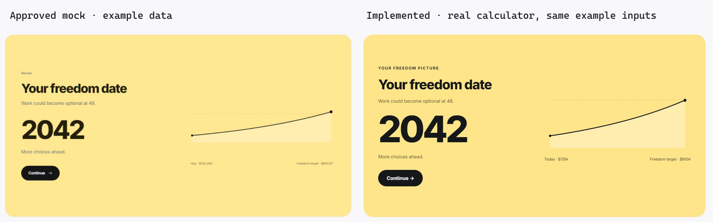
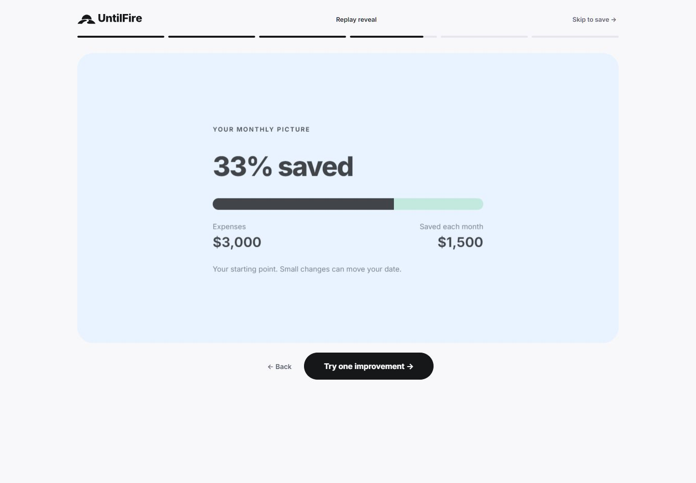
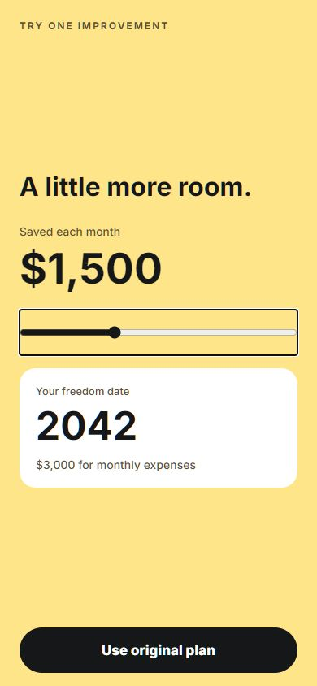
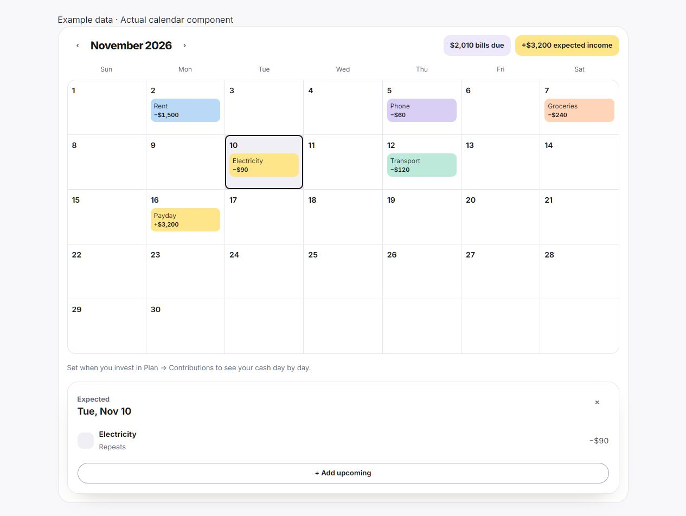
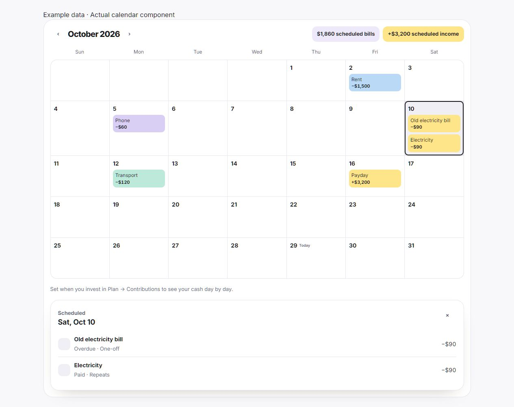

# Next Horizon visual and journey QA

29 October 2026. Baseline: origin/main d8ad674a71fddf284a96718ea8be7c3b30c57a2b. Implementation: codex/next-horizon-rebrand, in F:\Claude-Untilfire.

## Compared target

Approved website mock, Reveal screen (`web-onboard-11.png`) versus the real compiled route. Both full captures are 1440 × 1000 pixels at CSS viewport 1440 × 1000. The comparison below crops each yellow panel and normalises both to 700 × 370. Mock toolbar and browser surroundings are excluded. It contains fictional example data only; signed-in account screenshots are private and are not committed.

The newer approved horizon/path mark and outlined Inter wordmark supersede the older wordmark visible in the mock. The actual calculator produces age 48 for the example instead of the mock's illustrative age 49. The curve is calculated from the entered starting balance, saving and growth; it is not the mock's illustrative line. The larger year remains the primary hierarchy. These are intentional adaptations rather than missing implementation.

## Findings and fixes

- P1, fixed: phone amount input exceeded its container and scrolled sideways. Added minWidth/width constraints. At 390px, its measured bounds are inside the viewport; decimal input stays focused.
- P1, fixed: dark native theme leaked a dark surface into the yellow saving-pace result card with black text. The yellow frame now sets a light local card role and an explicit black primary action. Rechecked at 390 × 844.
- P1, fixed: final phone save screen used a black mark on dark ground. It now selects the inverse mark, visibly verified in the final exported app.
- P1, fixed: monthly summary compact rounding displayed $1,500 as $2k. Exact currency formatting replaces compact formatting for monthly figures; a regression check and the final compiled browser screen both verify $1,500 and $3,000. Compact formatting remains for large targets.
- P2, fixed: reveal padding and primary action were outside the approved canvas composition. Final screenshot measures 48px interior padding and a single Continue action inside the panel.
- P2, fixed: old green actions persisted in bank connection, transaction entry and feedback. Final feedback action computes to rgb(21,23,25); categorical and positive/negative financial colours remain distinct.

## Required fidelity surfaces

- Typography: local Inter 400–800, bold sans headings, tabular financial values. Outlined vector wordmark. No serif display face in the active routes reviewed.
- Layout rhythm: rounded desktop split canvas; responsive question flow; one Home column with Today first; Housing and Investing are separate questions. No horizontal overflow in reviewed 390px Profile/Home or 1440px public screens.
- Colours: approved warm yellow and black with mint/lilac/blue/pink roles. Yellow web charts retain readable light fills in either theme. Native Home chart ink and range pills use a fixed contrast palette on the yellow surface.
- Image quality: SVG marks/lockups, opaque app icons, transparent Android adaptive foreground/monochrome layers. Public OG routes return PNG successfully.
- Copy/content: monthly amounts, concise starting-point wording, no final Change my answers link, conditional Use original/updated plan, no invented city savings statistics.

## Functional evidence

Browser journey: ten questions → 2042 reveal → life → freedom number → monthly picture → savings pace → real Save with Google/Apple screen. Keyboard slider change moved December to August 2042, and restoring it returned the original plan and label. No sign-up or terms acceptance was performed.

Phone web build: all questions → reveal/life/number → monthly picture → saving pace → reminder skipped → Your plan → save account. Slider changes $1,500 to $1,510 and back, switching the single action correctly. Native iOS and Android retain the native slider; the web adapter uses an accessible range input. No notification permission or account creation was performed.

Signed-in web: Home, Money, Plan and Profile viewed read-only, desktop and 390px navigation checked, light/dark logo variants reviewed. No financial records were edited. Admin denied access to this login; no authorization bypass was attempted. Admin palette and journey source are updated, and all 22 journey routes/order checks pass, but authenticated admin visual review remains unverified.

Validation: npm run validate passed; final targeted builds/type checks and root lint passed with warnings. Phone lint/type checks passed (React Native Image alt warnings remain from using a web-oriented lint configuration). iOS, Android and web exports passed. Financial consistency 38/38, money rules, FIRE projection, currency selection, savings pace including FX round trips, save handoff including exact monthly values, achieved-target rendering, startup splash, calm startup, start CTAs, reveal tracking and journey guards passed.

## Scope of result

final result: passed

This result covers the compared public reveal and the reviewed responsive/functional surfaces described above. It is not a claim of pixel-for-pixel identity for every app state. Authenticated admin screenshots and physical-device/store-build verification remain release checks. New native icons/splash require a separately authorised store build. No production merge or phone release was performed.

### 29 October follow-up: category B and payday C without a visible slider

Implemented real web and native cards; money engines unchanged. Verified the real web component at desktop and 390px with the same seven example bills: mouse drag selected Insurance and $1,985 remaining; keyboard reached each same-day bill; details stayed above the chart; no range input and no horizontal page overflow. Separate shortfall and no-bills views were inspected. Safe fictional screenshot: next-horizon-qa/payday-c.png.

Checks passed: web production build (455 pages, existing lint warnings), web and phone types, changed-file lint, all-platform phone export (iOS/Android/web), category legacy mapping, payday selection/balance/date/empty/shortfall checks, 37 cash/free-to-spend checks in Asia/Shanghai and America/Los_Angeles, money-rule checks. Physical touch-device verification remains pending. No merge or release performed.

## Browser interaction pass — 29 October 2026

Baseline: latest pushed origin/main d8ad674, continuing the explicitly approved unmerged Next Horizon branch. Scope: public landing, onboarding/reveal/improvement, and signed-in Home/Money/Plan/Profile browser interactions. No production publication or account mutation.

1. Landing: static example lacked a way to try the outcome. Added an explicitly labelled example-only savings control using existing quickFreedom/freedomPath calculations, modelling extra income saved. Browser verified +$500/month moves the example from 2042 to 2041 and restoring zero restores the original. Actual account plan is untouched.
2. Onboarding: retain the existing question flow and stable numeric inputs; add directional step transitions, selected-answer feedback, press/hover/focus states and a consistently styled progress indicator. Back retains selected answers. Narrow screens hide decorative side illustrations, while the monthly money summary remains. Checked real entry of 4500.25 without losing focus, full ten-question path, reveal and exact monthly picture. Not all input/currency/error permutations visually audited.
3. Home/Money/Plan: Home/reveal already had entry animation; preserved it rather than claiming it was absent. Added section transitions without keyed remounts, editor disclosure feedback and shared button feedback. Replaced the observed near-empty transactions loading state with an accessible structural placeholder, no fake financial values. Actual Money and Plan loaded; section keys updated and the growth editor opened/closed without editing its amount.
4. Improvement: added a live income split and result transition. Browser checks found and reproduced decimal slider undo rounding 1500.25 to 1500, leaving Use updated plan. Fixed display precision and restoration to exact original USD; actual component verified right/left restores 1500.25 and Use original plan. Independent tests cover USD/HKD/EUR/JPY-style precision and conversion. This interaction fix is web-only; the native pace interaction is not claimed checked in this pass.

Responsive evidence: landing, onboarding and signed-in Home/Money/Plan/Profile checked at actual 390px browser width with scrollWidth <= innerWidth. Desktop navigation and decimal entry checked. Signed-in screenshots remain private in the current Codex visualization directory. Public screenshots use fictional inputs only. The initial startup splash capture was rejected; the loaded onboarding screenshot was inspected after splash dismissal.

Motion verification: tests cover reduced-motion initial state, live cancellation, listener cleanup and unsupported-animation fallback. CSS disables additional step/choice/progress animation under reduced motion. Browser checks verified selected-answer animation styling and navigation/editor structure. The browser inspection surface cannot expose active Web Animation instances, so exact frame timing is not independently measured. Physical touch devices, Safari and a full screen-reader audit remain unverified. Do not claim WCAG conformance or that every route is animated.

Validation: npm run validate passed before the final precision/responsive refinements; final production build, affected type/lint and focused regressions are rerun for those changes. Public preview remains local. No merge, push or deployment for this pass.

Final verification after the narrow-screen refinements: production build exited 0 (455 pages); affected lint has 0 errors and 2 pre-existing BrandedIntake warnings. Motion, savings/decimal-currency undo, start CTAs, reveal handoff and step-tracking checks passed. Loaded onboarding at 390px confirmed decorative panel display none and no page overflow; the inspected screenshot shows the black progress fill and all first-question actions without decorative-panel scrolling. Landing at 1280px and 390px updates 2042 to 2041 at +500/month with no horizontal overflow. Safe screenshots: next-horizon-qa/browser-motion-landing.png and browser-motion-onboarding-phone.png. Existing local preview restarted at port4200. Changes remain local/uncommitted after PR323's last pushed head; no merge, push or deployment was performed for these refinements.

## Onboarding feedback repairs — 29 October 2026

Reproduced city selection remaining London after typing Seoul. Fixed selection invalidation, trimmed search, known/custom result ambiguity, country flags, and conversion of existing answers on currency changes. Income/expenses retain decimal entry and focus; Saved mode gets the correct question heading. Visible Skip actions removed.

Improvement control displays whole numbers, steps in whole units and preserves the exact original plan on undo. Reveal shows exact values immediately, today-dollar target only, a real styled 100-cell year grid with a bounded wave (under 500ms), and a 500ms handoff. Reduced motion removes the grid animation.

Auth: existing local session was accessible at 127.0.0.1:4200/dashboard; localhost and the live IAB session are separate. Added existing-session Home action and recoverable errors. Mocked callback regression covers event races, consumed codes, missing/denied/slow/offline cases and Google-start errors without real auth requests. Fresh provider consent and live production authentication remain unverified. No account data changed.

Focused savings, city/FX, reveal motion, achieved-target/handoff and email/auth recovery checks passed. Full validation and final browser review recorded below when complete. Changes remain local; no merge/deployment.

Final feedback verification: final production build exited 0 (455 pages); full lint 0 errors, 113 warnings; typecheck passed. Browser reproduced and repaired Saved-mode keystroke corruption (1500.25 previously became 1500.1999999999998); Saved now retains its own input text and rounds the derived expense calculation. Rebuilt browser verified exact 1500.25, correct Saved heading, full question path, real 100-cell Life grid, today-only target, and improvement 1500 -> 1501 with Use updated plan. Existing 127.0.0.1 signed-in Home reloaded successfully. No save/sign-up/account mutation performed. Fresh production Google OAuth remains unverified.

## Marked calendar B — 29 October 2026

Baseline: fetched origin/main d8ad674; continued the explicitly approved local rebrand work, preserving existing uncommitted changes. User selected the right-hand B from the side-by-side chart/calendar comparison. Implemented one shared marked-month component for Money → Calendar and Transactions' Calendar alternative. Compared the selected mock with the real component using the same fictional November 2026 payments: 2010 bills and 3200 income. Sunday-first alignment, quiet cells, category pastels, yellow incoming labels and outlined selection match the chosen structure. Existing cash/contribution summaries and payment actions remain above/below it. Details are below rather than a phone overlay.

Desktop 1280px: date selection by keyboard, month navigation and the selected Electricity detail verified. Busy example: six payments on one day all appear individually and all six appear in selected-day details. Narrow 390px: no horizontal overflow, compact display-currency values fit after reducing inner cell padding; exact amounts remain in accessible names and details. Physical touch devices and a complete screen-reader audit are not claimed.

Real signed-in browser: Calendar page and Transactions Calendar alternative both load with actual saved data. Real Calendar at 390px has scrollWidth equal to innerWidth. No add, mark-done, import, account, or financial-record action performed. The existing recorded/pending sources and forecast engines remain unchanged; detected upcoming bills in Transactions and explicitly scheduled Calendar items remain distinct upstream sources.

Checks passed: npm run validate (two production builds, root types, lint with zero errors and existing warnings), focused calendar recurrence/month-crop/unpaid-income/refund/same-day/date-alignment/selection checks, 11 spend-range checks, 24 spend-forecast checks and money rules. git diff --check passes. Native calendar styling is outside this browser change; no money-engine or native-release change. Local only; no commit, push, merge or deployment.

### Calendar scheduled-date release repair

User reproduced overdue payments being carried onto today and requested bills-only calendars. Confirmed CalendarMonth used expandExpected, which intentionally carries overdue events to today for cash forecasting. Calendar presentation now uses the existing expandForMonth calendar expander on complete scheduled rows, including completed one-offs. It no longer consumes recorded history or the forecast's adjusted dates. Transactions' Calendar uses the same scheduled-row input rather than transaction history or detected-transaction bills; its transaction list and line/bars remain intact. Cash forecast remains independent and unchanged.

Focused regression proves: October 10 remains October 10 when today changes from October 29 to 30; today does not collect previous dates; ordinary bank-history rows never appear; completed bills, same-day bills, recurring/month-end/leap dates and payday remain; underlying cash forecast still reserves overdue money. Actual Calendar component render and browser fictional example confirm the repair. Selected October 10 shows the old bill as overdue; October 29 has no scheduled payments in that example.

Website publication authorized by John on 29 October, after the repair. All 38 financial consistency checks, money rules, safety cash, freedom date, account currency, FIRE projection, all 22 journeys, seven start CTAs and the new scheduled-date guard passed. Final validation and signed-in browser verification are release gates. Fresh Google consent, authenticated admin and physical native-device QA remain unverified; no store submission or native update promotion is authorized here.

Final release checks passed: npm run validate exited 0 (455 pages, zero lint errors), mobile TypeScript exited 0, all focused browser-motion/category/payday/intake/auth/reveal/savings handoff guards passed. Rebuilt signed-in Calendar and Transactions Calendar verified read-only: scheduled summaries load, historical bank transfer markers are absent, and past scheduled markers remain on their dates. The one marker genuinely scheduled on today stays there; past dates are not collected onto today. Publication authorized; production verification follows the GitHub/Vercel deployment.

